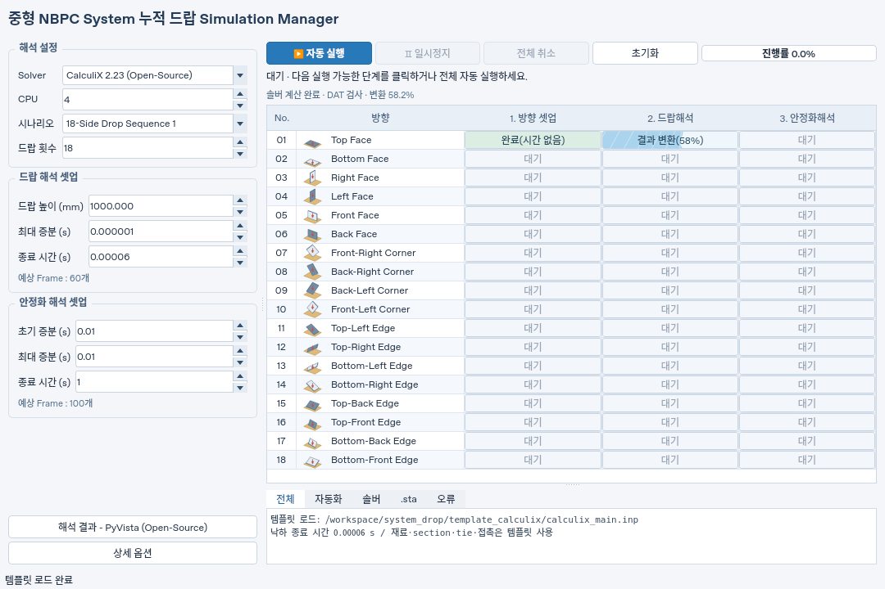

# System Drop

Windows용 누적 낙하 해석 Manager. CalculiX / Abaqus 입력과 PyVista 결과창을 제공합니다.
배포는 **기본 오프라인 설치본 + 작은 누적 업데이트** 방식입니다.

## 최신 v0.12.4 업데이트 — MemoryError 개선

**[v0.12.4 누적 업데이트 ZIP 다운로드 · 약 210 KB](https://github.com/younghuni0117-cloud/System_Drop/raw/refs/heads/main/downloads/system_drop_v0.12.4_update.zip)**

대용량 FRD/DAT 전체 이력을 RAM에 올리던 결과 변환 구조를 바꾸었습니다.
원본을 순차 검사한 뒤 필요한 실제 프레임만 한 프레임씩 읽고 저장합니다.
버튼은 결과 변환(XX%)와 최종 검증 중을 표시합니다.

1. Manager와 결과창을 닫습니다. 별도 계산이 진행 중이면 현재 단계 완료 후 일시정지합니다.
2. ZIP 전체를 임시 폴더에 압축 해제합니다.
3. **apply_update.bat** 실행 → **기존 start_windows.bat이 있는 system_drop 폴더** 선택.
4. 기존 start_windows.bat으로 실행합니다.

v0.11.0 이후의 이전 패치를 모두 포함합니다. 기존 INP·설정·runs·라이브러리·솔버를 유지하며 변경 소스는 backups 폴더에 먼저 백업합니다. 추가 패키지 설치는 없습니다.

### 솔버 완료 후 변환만 실패했다면

**FRD/DAT/job.rout/solver_completed.json을 포함한 doe 폴더 전체를 보존**하세요.
업데이트 후 **이전 실행 폴더 열기 / 재개**로 실패한 doe를 열고 자동 실행 또는 실패 단계 버튼을 누릅니다.
원본 해시·완료 상태가 확인되면 **솔버를 재실행하지 않고 변환부터 복구**합니다.
[자세한 복구·변경·검증 안내](updates/v0.12.4/CHANGES.md).

자동 테스트 **197개 통과**. 실제 약 500MB 결과에서 72개 배열과 최종 상태가 기존 결과와 완전히 일치했습니다.
해당 Linux 시험의 최대 RSS는 약 69.5 MiB였습니다. 모델과 환경에 따라 메모리·시간은 달라집니다.
[대용량 시험](updates/v0.12.4/streaming0124_summary.json) · [재계산 없는 복구 시험](updates/v0.12.4/resume0124_summary.json).

## 최초 오프라인 설치 — 기본 v0.11.0

GitHub 단일 파일 제한에 맞춘 363MB 원본 ZIP의 분할 파일입니다.
아래 **분할 5개 + join_files.bat**을 모두 같은 폴더에 원래 파일명으로 저장하세요.

- [분할 1 다운로드](https://github.com/younghuni0117-cloud/System_Drop/raw/refs/heads/main/downloads/system_drop_offline.zip.part001)
- [분할 2 다운로드](https://github.com/younghuni0117-cloud/System_Drop/raw/refs/heads/main/downloads/system_drop_offline.zip.part002)
- [분할 3 다운로드](https://github.com/younghuni0117-cloud/System_Drop/raw/refs/heads/main/downloads/system_drop_offline.zip.part003)
- [분할 4 다운로드](https://github.com/younghuni0117-cloud/System_Drop/raw/refs/heads/main/downloads/system_drop_offline.zip.part004)
- [분할 5 다운로드](https://github.com/younghuni0117-cloud/System_Drop/raw/refs/heads/main/downloads/system_drop_offline.zip.part005)
- [join_files.bat 다운로드](https://github.com/younghuni0117-cloud/System_Drop/raw/refs/heads/main/downloads/join_files.bat)

join_files.bat 실행 → 생성된 ZIP 전체 압축 해제 → 위 **최신 v0.12.4 업데이트** 적용 → start_windows.bat 실행.
Windows 10/11 x64용 Python과 로컬 설치 패키지를 포함합니다. 오프라인 환경에서는 기본 설치본을 매번 다시 받을 필요가 없습니다.

원본 오프라인 ZIP SHA-256:
`38077357d358853468fc020d3099217bf401091bc1eb83d433bc9edb33184398`

## 검증과 이전 변경 기록

실제 FEM 계산은 Linux CalculiX 2.23에서 시험했습니다. 실제 Windows 실행과 라이선스가 필요한 Abaqus 실행은 이 개발 환경에서 미검증입니다.
임의 Abaqus 키워드 조합의 지원 범위는 배포본의 docs/TEMPLATE_COMPATIBILITY.md를 확인하세요.

- [v0.12.3 Windows 실행 환경·충돌 진단](updates/v0.12.3/CHANGES.md)
- [v0.12.2 결과창 실행 경로](updates/v0.12.2/CHANGES.md)
- [v0.12.1 GUI 시작 인수](updates/v0.12.1/CHANGES.md)
- [v0.12.0 결과창·방향 모식도](updates/v0.12.0/CHANGES.md)

배포본의 CalculiX 및 타사 구성요소는 각 라이선스·고지를 따릅니다.
