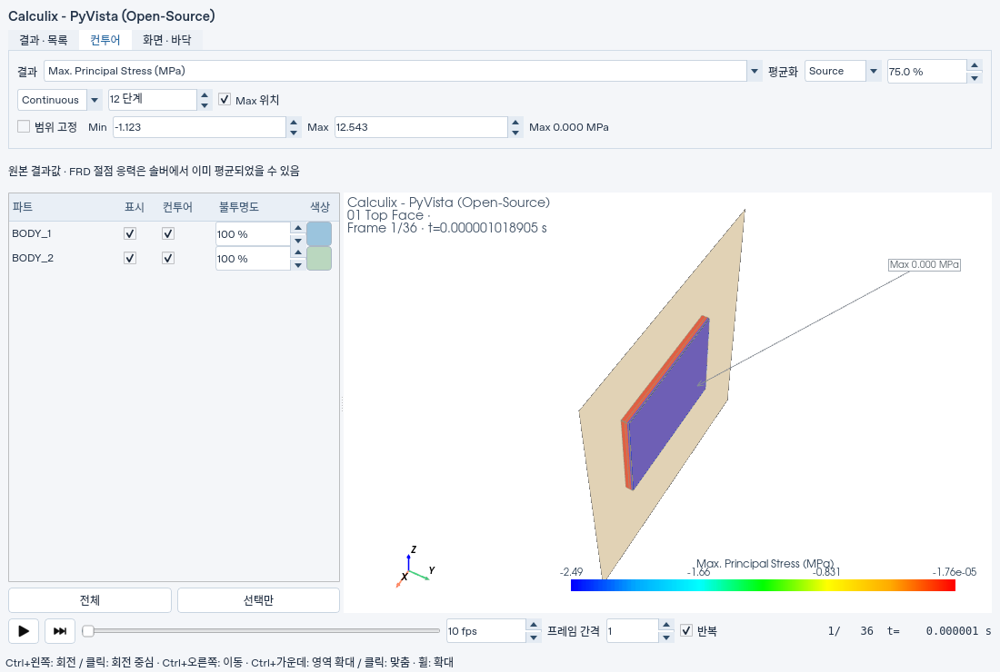
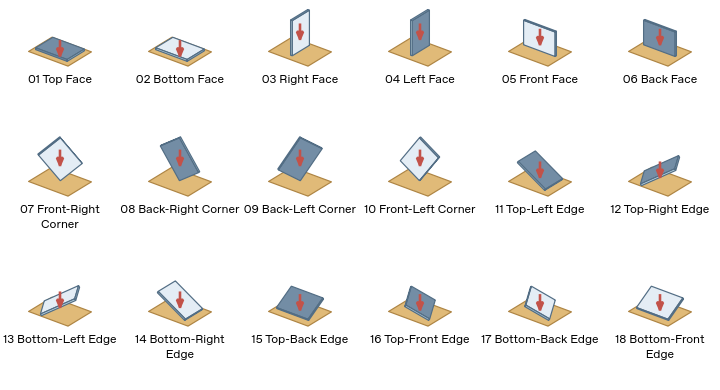

# System Drop

## v0.12.2 — 완료 버튼 결과창이 열리지 않는 오류 수정

**[최신 v0.12.2 누적 업데이트 ZIP 다운로드 — 약 193 KB](https://github.com/younghuni0117-cloud/System_Drop/raw/refs/heads/main/downloads/system_drop_v0.12.2_update.zip)**

`ModuleNotFoundError: No module named 'system_drop'`로 결과창이 종료되는 오류를 수정했습니다. 프로그램을 이동하거나 이전 설치의 Python 환경을 재사용할 때에도 현재 프로그램의 결과창을 찾도록 보완했습니다.

1. 해석 중이면 **현재 단계 완료 후 일시정지**하고 실제 대기 상태를 확인합니다.
2. Manager와 결과창을 닫습니다.
3. ZIP 전체를 임시 폴더에 풀고 **apply_update.bat** 실행.
4. **기존 start_windows.bat이 있는 system_drop 폴더** 선택.
5. 기존 프로그램을 다시 실행하고 필요하면 **이전 실행 폴더 열기 / 재개**로 doe 폴더를 엽니다.

v0.11.0부터 v0.12.1까지 적용할 수 있는 누적 패치입니다. 이전 개선과 수정도 포함하며 라이브러리·솔버를 다시 설치하지 않습니다. 기존 INP·설정·결과는 유지하고 변경 소스만 백업합니다.

자동 테스트 **184개 통과**, 격리 Python에서 실제 Qt/VTK 결과창 5개 경로 기동 확인. 실제 Windows 실행은 미검증입니다. [변경·검증·적용 안내](updates/v0.12.2/CHANGES.md).

---

## 이전 v0.12.1 — 최신 v0.12.2에 포함

**[최신 v0.12.1 누적 업데이트 ZIP 다운로드 — 약 188 KB](https://github.com/younghuni0117-cloud/System_Drop/raw/refs/heads/main/downloads/system_drop_v0.12.1_update.zip)**

v0.11.0 / v0.11.1 / v0.12.0에 적용합니다. v0.12.0 결과 창 개선과 이전 시작 경로 수정도 모두 포함합니다. 다른 패치를 먼저 적용할 필요가 없습니다.

1. Manager와 결과 창을 닫습니다.
2. ZIP 전체를 임시 폴더에 압축 해제합니다.
3. **apply_update.bat**을 실행하고, **기존 start_windows.bat이 있는 system_drop 폴더**를 선택합니다.
4. 완료 후 기존 start_windows.bat을 실행합니다.

내부 실행 인수 --gui가 GUI의 인수 파서로 넘어가지 않게 수정했습니다. 기존 모델·결과·설정·솔버·라이브러리는 유지합니다. 변경 파일은 backups 폴더에 먼저 백업합니다.

자동 테스트 **182개 통과**. 실제 Linux Qt 환경에서 일반/오프라인 부트스트랩 → 기존 라이브러리 재사용 → GUI 창 생성 → 정상 종료를 모두 확인했습니다. 실제 Windows 실행은 미검증입니다. [변경 내용과 수동 적용](updates/v0.12.1/CHANGES.md).

---

## 이전 v0.12.0 — 최신 v0.12.1에 포함

**[v0.12.0 업데이트 ZIP 다운로드 — 약 185 KB](https://github.com/younghuni0117-cloud/System_Drop/raw/refs/heads/main/downloads/system_drop_v0.12.0_update.zip)**

기존 v0.11.0 / v0.11.1에 적용하는 누적 패치입니다. 시작 오류 수정도 포함하므로 이전 패치를 따로 적용할 필요는 없습니다. 새로운 라이브러리나 솔버 설치가 없습니다.

1. Manager와 결과 창을 닫습니다.
2. 업데이트 ZIP **전체**를 임시 폴더에 압축 해제합니다.
3. **apply_update.bat**을 실행합니다.
4. 선택 창에서 **기존 start_windows.bat이 있는 system_drop 폴더**를 선택합니다.
5. 완료되면 기존 start_windows.bat을 실행합니다.

변경 파일은 backups 폴더에 먼저 백업합니다. 기존 runs·사용자 INP 템플릿·라이브러리·솔버·설정은 유지합니다. Windows 업데이트 BAT/PowerShell은 이 개발 환경에서 실제 실행 미검증입니다. 수동 적용 방법은 [변경 내용](updates/v0.12.0/CHANGES.md)을 참고하세요.

주요 변경: Max 박스/값만 표시, 전체 물리량 이름과 최대·최소 주응력, 입력 폭 개선, 기호 재생/멈춤, 클래식 마우스, 음영 조절·외곽선·흰 배경, 방향 모식도 개선.

자동 테스트 **182개 통과**, 실제 Linux Qt/VTK UI와 GIF 프레임 간격 내보내기 확인. [검증 요약](updates/v0.12.0/viewer012_summary.json).

---

## 이전 패치 v0.11.1 — v0.12.0에 포함

v0.11.0 실행 중 **No module named 'offline_setup'** 오류가 발생하면 아래 패치를 적용하세요.

**[시작 오류 수정 패치 ZIP 다운로드](https://github.com/younghuni0117-cloud/System_Drop/raw/refs/heads/main/downloads/system_drop_v0.11.1_startup_fix.zip)**

1. 패치 ZIP을 임시 폴더에 압축 해제하세요.
2. 안의 파일과 폴더를 **기존 start_windows.bat이 있는 system_drop 폴더**에 복사하고 덮어쓰세요.
3. 기존 폴더를 삭제하지 말고 병합하세요. 다시 start_windows.bat을 실행하세요.

363 MB 배포본을 다시 받을 필요는 없습니다. 라이브러리·솔버·runs는 삭제하거나 강제 재설치하지 않습니다. 처음 설치할 때는 아래 기본 배포본을 받은 뒤 최신 v0.12.2 업데이트를 적용하세요.

격리 모드에서 기존 오류 재현 및 수정 확인, 자동 테스트 **174개 통과**. 실제 Windows 실행은 미검증입니다.

---

## 기본 배포본 v0.11.0

Windows용 누적 낙하 해석 매니저. CalculiX / Abaqus 템플릿과 PyVista 결과 뷰어를 제공합니다.

## 오프라인용 다운로드

GitHub 단일 파일 제한에 맞춰 원본 ZIP을 5개로 분할했습니다. **아래 6개 파일을 모두 같은 폴더에 원래 파일명 그대로 저장하세요.**

- [분할 1 다운로드](https://github.com/younghuni0117-cloud/System_Drop/raw/refs/heads/main/downloads/system_drop_offline.zip.part001)
- [분할 2 다운로드](https://github.com/younghuni0117-cloud/System_Drop/raw/refs/heads/main/downloads/system_drop_offline.zip.part002)
- [분할 3 다운로드](https://github.com/younghuni0117-cloud/System_Drop/raw/refs/heads/main/downloads/system_drop_offline.zip.part003)
- [분할 4 다운로드](https://github.com/younghuni0117-cloud/System_Drop/raw/refs/heads/main/downloads/system_drop_offline.zip.part004)
- [분할 5 다운로드](https://github.com/younghuni0117-cloud/System_Drop/raw/refs/heads/main/downloads/system_drop_offline.zip.part005)
- [join_files.bat 다운로드](https://github.com/younghuni0117-cloud/System_Drop/raw/refs/heads/main/downloads/join_files.bat)

1. 분할 파일 5개와 `join_files.bat`을 같은 폴더에 저장합니다.
2. `join_files.bat`을 실행하면 `system_drop_v0.11.0_windows_offline.zip`이 생성됩니다.
3. 생성된 ZIP 전체를 압축 해제한 후 `start_windows.bat`을 실행합니다.

Windows 10/11 x64용 Python과 로컬 설치 패키지를 포함합니다. 자세한 안내는 압축 안의 `docs/OFFLINE_WINDOWS.md`에 있습니다. 기존 runs 폴더는 별도로 백업해서 옮기세요.

원본 오프라인 ZIP SHA-256:

`38077357d358853468fc020d3099217bf401091bc1eb83d433bc9edb33184398`

## 일반판 다운로드

[일반판 ZIP 다운로드 — 약 29 MB](https://github.com/younghuni0117-cloud/System_Drop/raw/refs/heads/main/downloads/system_drop_v0.11.0_windows.zip)

일반판은 필요한 환경이 없으면 인터넷 연결이 필요합니다. 오프라인 PC에서는 위 분할 배포본을 사용하세요.

## 검증 범위

- 자동 테스트 170개 통과.
- Linux CalculiX 2.23에서 새 2재질 모델의 누적 낙하 2회 및 각 안정화 해석 완료.
- Windows 패키지 의존성 및 해시 검증 완료. **실제 Windows 오프라인 설치와 라이선스가 필요한 Abaqus 실행은 미검증입니다.**
- Abaqus 템플릿의 지원 범위는 배포본의 `docs/TEMPLATE_COMPATIBILITY.md`를 확인하세요.

배포본에 포함된 CalculiX 및 타사 구성요소의 라이선스·고지는 배포본 안의 관련 문서를 따릅니다.
